<a href="https://www.burakerdemci.com"></a>

  <a href="https://www.burakerdemci.com"><b>burakerdemci.com</b></a>
  &nbsp;·&nbsp;
  <a href="https://www.linkedin.com/in/burak-erdemci-a3994833b/"><b>LinkedIn</b></a>
  &nbsp;·&nbsp;
  <a href="mailto:erdemciburakemre@gmail.com"><b>erdemciburakemre@gmail.com</b></a>

 

<a href="https://www.linkedin.com/in/burak-erdemci-a3994833b/"></a>

Intern, Digital Design · Eczacıbaşı VitrA (İME) · since Sep 2026

 

<a href="https://github.com/BurakErdemci?tab=repositories"></a>

<a href="https://github.com/BurakErdemci/gamachine"></a>

<a href="https://github.com/BurakErdemci/gamachine">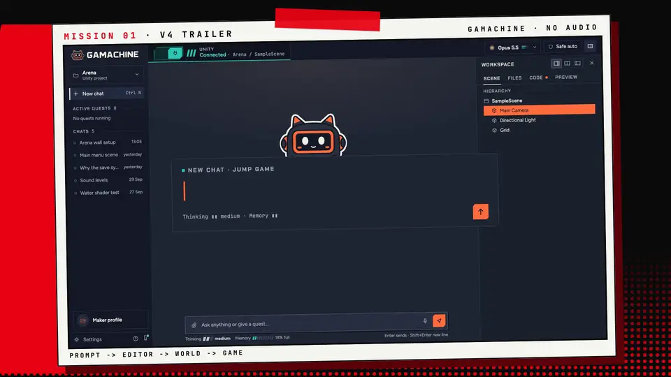</a>

<a href="https://github.com/BurakErdemci/gamachine"><b>Gamachine</b></a> &nbsp;·&nbsp; <a href="https://github.com/BurakErdemci/gamachine/releases/latest">latest release (v3.2.0)</a> &nbsp;·&nbsp; v4 in development &nbsp;·&nbsp; MIT

 

<a href="https://burakerdemci.github.io/kagit-kart/"></a>

<!-- kagit-kart-loop -->

<a href="https://burakerdemci.github.io/kagit-kart/"><b>Play Kâğıt Kart in the browser</b></a> &nbsp;·&nbsp; <a href="https://github.com/BurakErdemci/kagit-kart">source</a> &nbsp;·&nbsp; three.js, zero asset files

 

<a href="https://github.com/BurakErdemci/codex-delegate"></a>

<a href="https://github.com/BurakErdemci/codex-delegate"><b>codex-delegate</b></a> &nbsp;·&nbsp; Claude Code plugin &nbsp;·&nbsp; MIT

 

<a href="https://github.com/pulls?q=is%3Apr+author%3ABurakErdemci+is%3Amerged"></a>

<a href="https://github.com/pulls?q=is%3Apr+author%3ABurakErdemci+is%3Amerged"></a>

<a href="https://github.com/CoplayDev/unity-mcp/pull/1337">unity-mcp #1337</a> &nbsp;·&nbsp; <a href="https://github.com/CoplayDev/unity-mcp/pull/1338">unity-mcp #1338</a> &nbsp;·&nbsp; <a href="https://github.com/nrwl/nx/pull/37074">nx #37074</a> &nbsp;·&nbsp; <a href="https://github.com/badges/shields/pull/12177">shields #12177</a>

 

<a href="https://github.com/BurakErdemci?tab=repositories"></a>

<a href="https://github.com/BurakErdemci?tab=repositories"></a>

Unity · C# · three.js · MCP · Python · FastAPI · TypeScript · React · Next.js · Electron · MongoDB · Docker

 

<a href="https://github.com/BurakErdemci/music-video-lab"></a>

<a href="https://github.com/BurakErdemci/music-video-lab"></a>

<a href="https://www.youtube.com/watch?v=J37b5WfH-7w">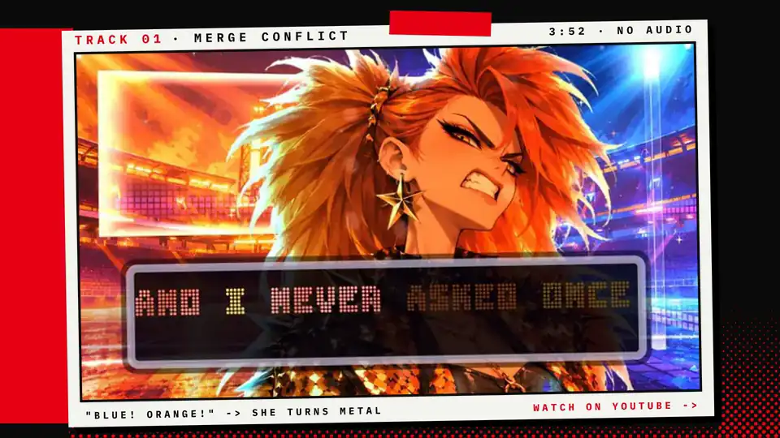</a>

<a href="https://www.youtube.com/watch?v=J37b5WfH-7w"><b>Merge Conflict</b></a> &nbsp;·&nbsp; 3:52 &nbsp;·&nbsp; a kawaii heavy-metal disco battle of two girls over one line of code &nbsp;·&nbsp; <a href="https://github.com/BurakErdemci/music-video-lab/tree/main/merge-conflict">source</a>

<a href="https://www.youtube.com/watch?v=j-LT1IEJDvk">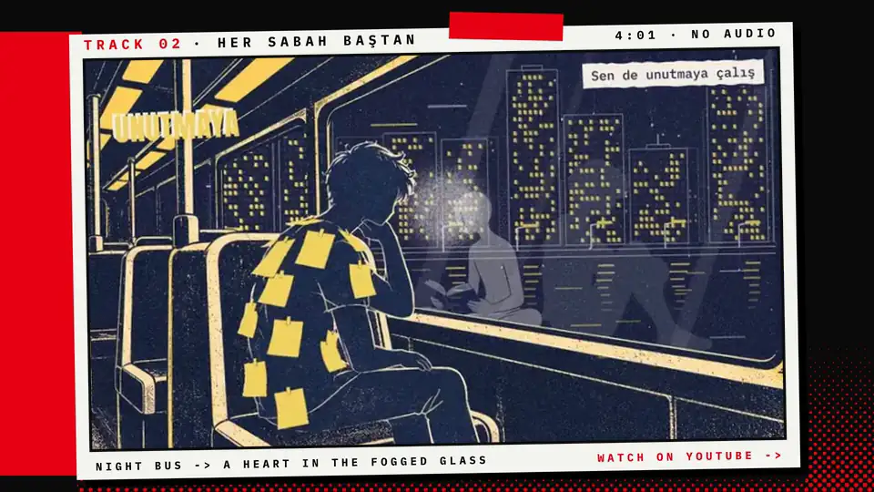</a>

<a href="https://www.youtube.com/watch?v=j-LT1IEJDvk"><b>Her Sabah Baştan</b></a> &nbsp;·&nbsp; 4:01 &nbsp;·&nbsp; a Turkish duet about an AI that meets its human for the first time every morning &nbsp;·&nbsp; <a href="https://github.com/BurakErdemci/music-video-lab/tree/main/her-sabah-bastan">source</a>

<a href="https://www.youtube.com/watch?v=QUtyszbWdDg">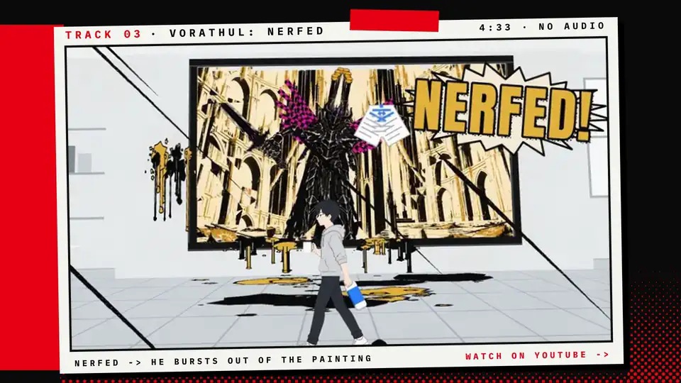</a>

<a href="https://www.youtube.com/watch?v=QUtyszbWdDg"><b>Vorathul: NERFED</b></a> &nbsp;·&nbsp; 4:33 &nbsp;·&nbsp; a symphonic metal anthem of a final boss who is nerfed in a patch &nbsp;·&nbsp; <a href="https://github.com/BurakErdemci/music-video-lab/tree/main/vorathul-nerfed">source</a>

 

<a href="https://github.com/BurakErdemci?tab=repositories"></a>

<a href="https://ristorante-stellato-puum.vercel.app"></a>

<a href="https://ristorante-stellato-puum.vercel.app"><b>Ristorante Stellato live demo</b></a> &nbsp;·&nbsp; <a href="https://github.com/BurakErdemci/ristorante-stellato">source</a>

 

<a href="https://burakerdemci.itch.io/workdayloop"></a>

<a href="https://burakerdemci.itch.io/workdayloop"><b>Play Workday Loop on itch.io</b></a> &nbsp;·&nbsp; <a href="https://github.com/BurakErdemci/Workday-Loop">source</a>

 

<a href="mailto:erdemciburakemre@gmail.com"></a>

  <a href="https://www.burakerdemci.com"><b>burakerdemci.com</b></a>
  &nbsp;·&nbsp;
  <a href="https://www.linkedin.com/in/burak-erdemci-a3994833b/"><b>LinkedIn</b></a>
  &nbsp;·&nbsp;
  <a href="mailto:erdemciburakemre@gmail.com"><b>erdemciburakemre@gmail.com</b></a>
   
  Eskişehir, TR &nbsp;·&nbsp; open to remote work

